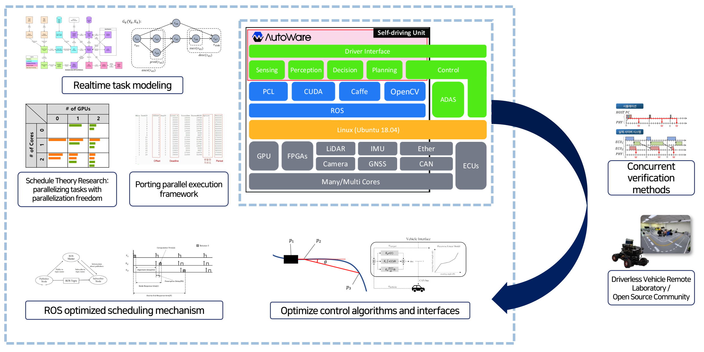
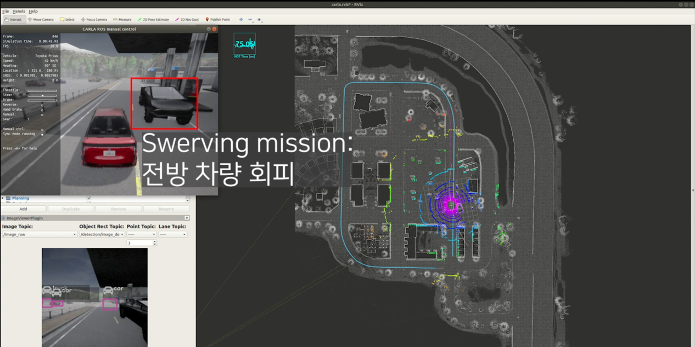
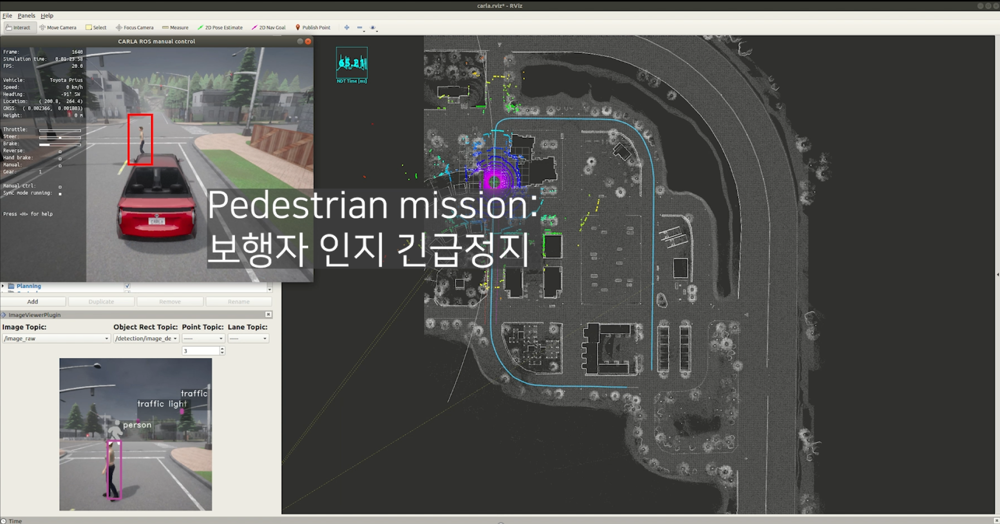
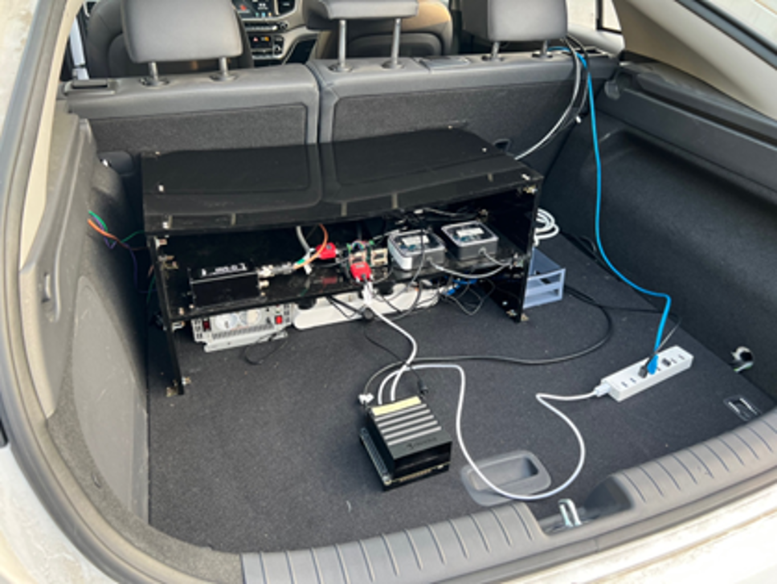
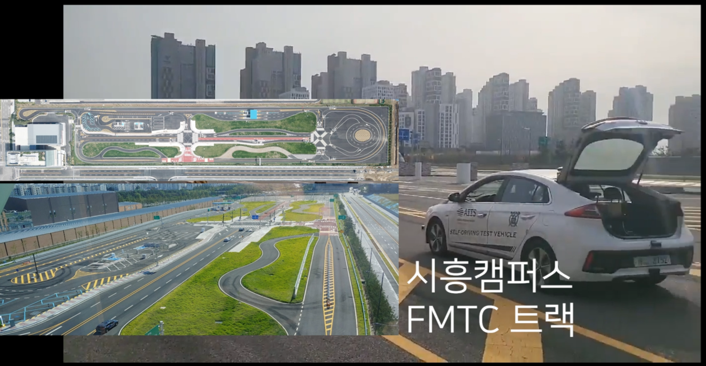
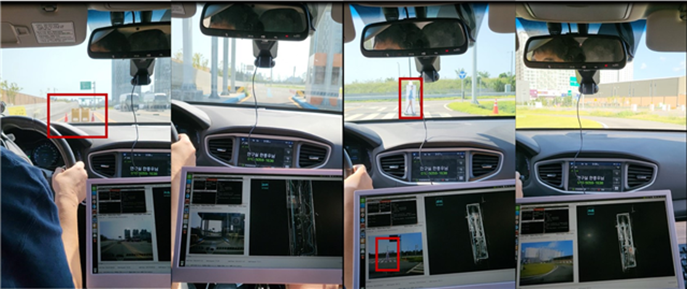

Multicore/GPGPU HW/SW Platform

Swerving mission in Carla simulator

Pedestrian mission in Carla simulator

Real vehicle control board setting

Real vehicle in FMTC track

Perform autonomous driving missions with real-world vehicles (avoid obstacles, pass through toll booths, make emergency stops after detecting pedestrians, drive around challenging curves)

Usage and configuration information for this platform is organized in the following link : <a href="{{'https://github.com/rubis-lab/Autoware_On_Embedded'}}">Github</a>
