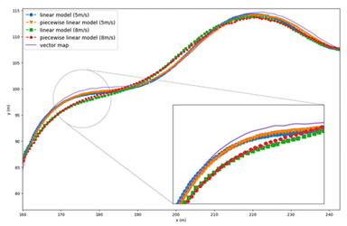
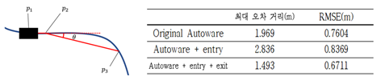
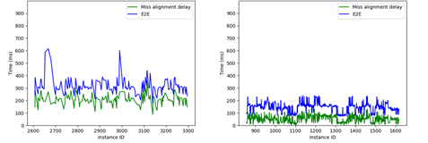

We developed and applied a piecewise linear model-based steering control technique for optimizing the steering control of the platform we built. The technique dynamically changes the pre-tuned steering control parameters according to the speed to improve the control performance. As shown in the figure below, when using a piecewise linear model at the same speed for a vectormap corresponding to the default path, the distance error to the vectormap at the same speed is reduced compared to a linear model with static control parameters, enabling more precise steering control.

Improved control performance with piecewise linear model-based steering control

We developed and applied a dynamic speed control technique based on path curvature calculation to improve the control performance of the platform. This technique calculates the entry into the curve based on the curvature and dynamically controls the vehicle speed based on the calculated curvature value. Curvature calculation is performed by defining vehicle position p1, vehicle straight ahead position p2, and forward position p3 relative to the driving path based on predefined parameters and calculating the angle θ between p1-p2 straight line and p2-p3 straight line as shown in the left side of the figure below. If the value of θ exceeds a threshold, the vehicle is determined to have entered a curved main road, and the driving speed is dynamically changed considering the current vehicle speed and θ. Dynamic speed control is available in a mix of ENTRY, which is applied only when entering the curve, and EXIT, which is applied for a period of time after exiting the curve. As shown in the right side of Figure 9, we applied it to the target autonomous driving application, Autoware, and found that the maximum error distance from the default path was reduced by 24.17% and the root mean square error (RMSE) was reduced by 11.74% when applying dynamic entry and exit.

(Left) Path curvature calculation (Right) Control performance with dynamic speed control

Event-driven mechanism was applied to the platform for optimal utilization of the CPU scheduling module and validated. Existing Autoware-based targeted autonomous driving applications use a periodic polling-based mechanism in which internal nodes (component units that perform a single function) periodically wake up and perform callbacks on received data, if any, and otherwise sleep until the next cycle. This mechanism introduces a Miss Alignment Delay (MAD), where if data is received while a node is sleeping, its execution is delayed until the next cycle. This is not related to the algorithm performance, but to the inefficient utilization of CPU scheduling, and needs to be improved at the system level. Therefore, we reconfigured the nodes of the target autonomous driving application to operate as event-driven. To evaluate the performance improvement, we ran the autonomous driving application on the Carla simulator, and as shown in Figure 10 on the left, the average E2E is 314ms and the average MAD is 208ms for the existing autonomous driving application, while the average E2E is reduced by 58% to 132ms and the average MAD is reduced by 75% to 52ms for the event-driven application on the right. In addition, when the speed is 10m/s, the existing application fails to follow the location and cannot drive normally, while the Event-Driven application can drive without any problems.

(Left) Experimental results of conventional autonomous driving application (Right) Experimental results of Event-Driven mechanism application

To optimize the parallel framework layer, we added an in-platform parallelism setting function and built a function to explore the optimal parallelism using our research results. Added the ability to change parallelism based on parameters for parallelizable nodes in the platform. If the number of parallelizable nodes increases through the addition of new features or improvements, the same parallelism change technique can be applied to expand the functionality. In addition, based on the optimal parallelization search theory techniques developed in the course of this project, we built a function to automatically search for optimal parallelism given the task information of the target system. This allows users with limited prior knowledge of real-time system theory to easily use the optimization techniques developed by this research team.

For developers  : <a href="{{'https://github.com/rubis-lab/Autoware_On_Embedded'}}">Github</a>
