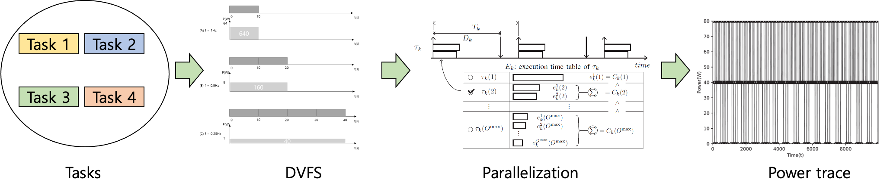

Developed an optimal scheduling theory based on a fixed-priority scheduler in a mixed-criticality model for high-performance ECUs with lockstep/performance mode switch, which has been recently announced in the industry. The developed scheduling method utilizes the Hierarchical Scheduling technique and guarantees a utilization bound of 1.0, which is an optimal schedule test. It can simultaneously secure safety by using the lockstep mechanism for critical tasks and resource efficiency by utilizing the parallelism of multi-core for non-critical tasks.

Optimal Exploitation of Multicore/GPGPU Parallelism Power Optimization Extensions to Schedule Theory

Devised a power consumption measurement technique to check for power optimization. Developed a relative power measurement program based on the relationship between CPU core frequency and power and parallelization options and power. Added power consumption to the task model of parallelism-optimized scheduling theory. Used Global-EDF to find the power, CPU core frequency, and parallelization option for each task that minimizes power consumption while all tasks meet their deadlines. Using power consumption measurement techniques, found an average reduction in power consumption of 36.35%.

For developers  : <a href="{{'https://github.com/rubis-lab/popt-dev'}}">Github</a>
