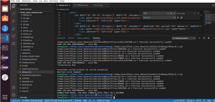
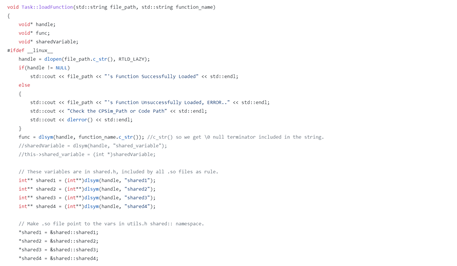

To ensure the accuracy of simulation results, applying a wellknown development methodology such as the V-model process is crucial. Simulation-based development plays an essential role in the early stage of the V-model process, helping to save time and labor costs. The functionally and temporally correct simulation methodology that we developed can accurately verify the cyber systems of automotive systems, replicating physical interaction points to send or receive the same data as the actual cyber system. This methodology is not only accurate but also efficient, allowing for job execution scheduling to simulate accuracy and efficiency. We also present the implementation of a simulation tool using this methodology and shows better results than other simulation tools. Finally, the optimization of the simulation tool's schedule simulation engine, control program real-time execution engine, and smooth migration support function has led to improved performance, simulation capacity, and versatility.

The existing schedule simulation engine module is difficult to use in the Linux environment because the unmanned vehicle design/verification tool developed by our research team is optimized for the Windows environment. In response, we optimized the OS to ensure the same functionality in the Linux environment as in the Windows environment. In addition, we improved the data structure required for schedule simulation. In the existing code, the task information, all task instances of the task, and scheduler information are stored in one data structure to predict the task execution behavior of each ECU while the simulator is running, which increases the complexity unnecessarily, but it is modularized by separately configuring a data structure to store ECU information, a data structure to store task information, and a data structure to store task instances.  

Simulation also performed in Linux environment (based on Ubuntu 18.04) through OS optimization

Since the autonomous program execution engine is also optimized for the Windows environment, the research team recognized that it is difficult to apply the autonomous program execution method that can be performed in the Windows environment. In the Windows environment, the control program code for each ECU is automatically generated and compiled and linked at the same time as the simulation, so it is possible to execute the autonomous control program in the simulation as the simulation progresses, but this function is not supported in the Linux environment, so we redesigned it in a way that fits the Linux environment. The process of first analyzing the user's speech and automatically generating the control program code using the corresponding ECU codes, and then compiling it into a shared object file is dynamically performed at the simulation initialization stage, and after confirming that the .so file extension is created, the contents of the core function of the file extension are implemented in the simulator's autonomous control program execution engine. In addition, the execution engine has been improved to utilize the parallelism of multicore by separating simulation tasks into multiple threads and assigning them to cores in a best-fit manner when the environment of the PC running the simulation is multicore. 

Implementation of the Dynamic Loading technique for running control programs dynamically in a Linux environment

The research team extended the data communication interface between ECUs that comprise a cyber system so that the Smooth Migration feature can support more diverse environments. The existing data communication interface was developed assuming CAN communication, which is commonly used in the automotive industry, but we recognized that control programs performed on ECU boards today use Ethernet communication because they need to send and receive large amounts of data. In response, the communication interface has been extended to support Ethernet communication. Therefore, we optimized it so that the user can select each communication method and simulate the cyber system with the corresponding communication interface.

For developers  : <a href="{{'https://github.com/rubis-lab/CPSim_Linux_Generalized'}}">Github</a>
